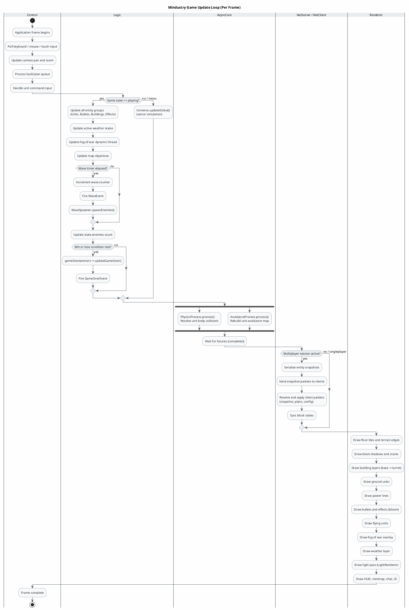
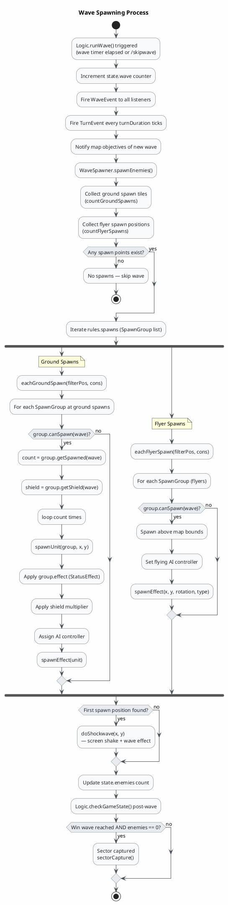
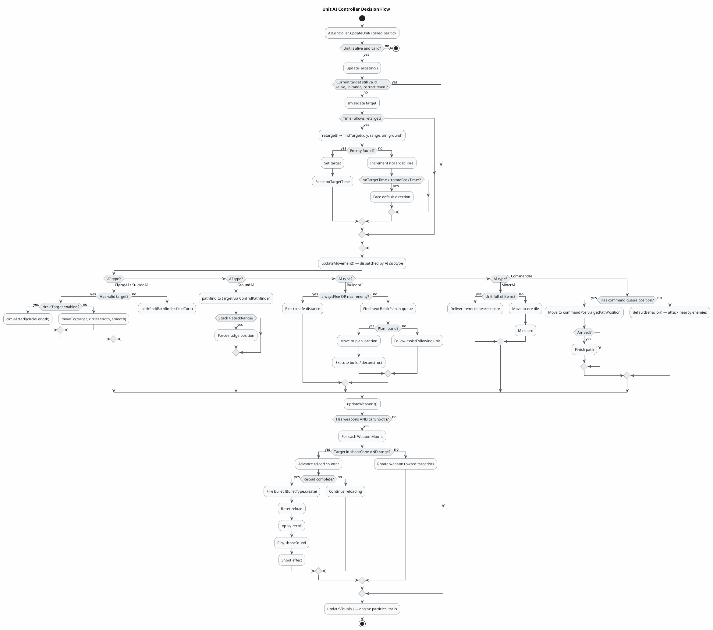
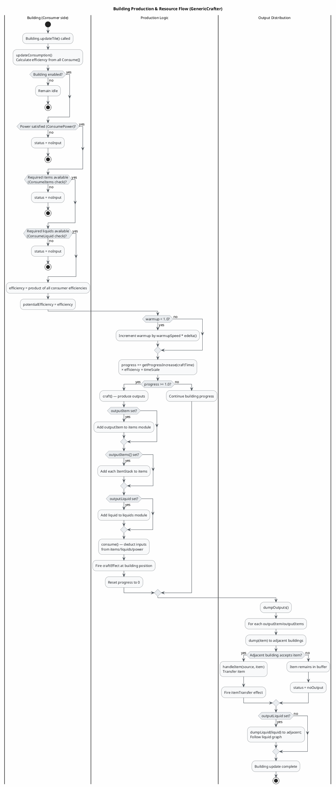

Looking at the Mindustry IR, I'll generate three focused activity diagrams covering the most important workflows: the game update loop, the wave spawning process, and the unit AI decision flow.

---

---

---

---

