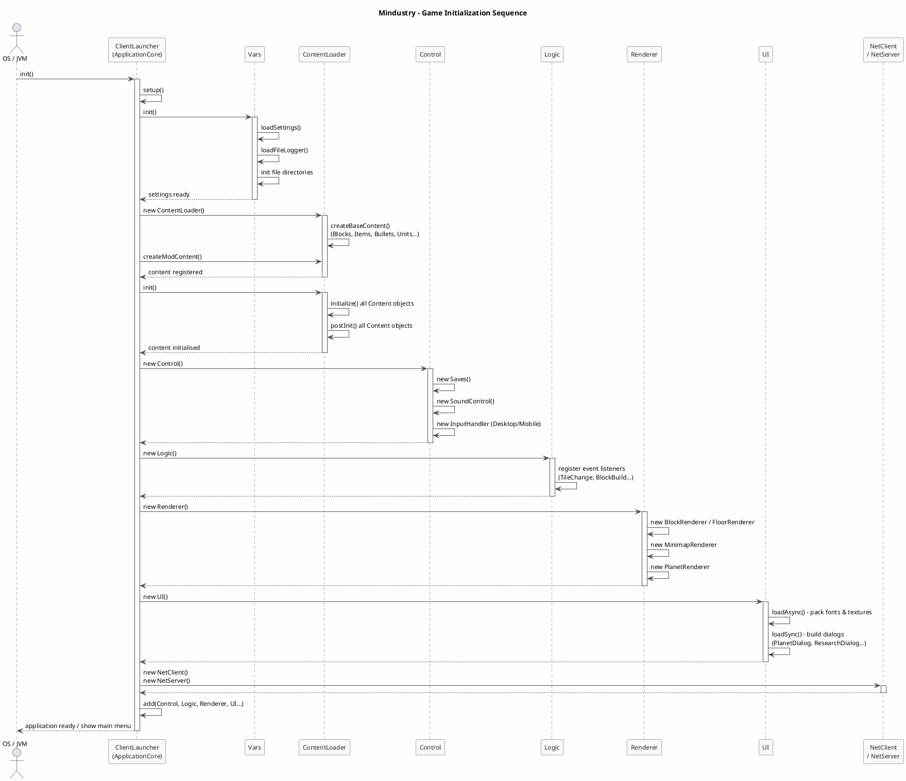
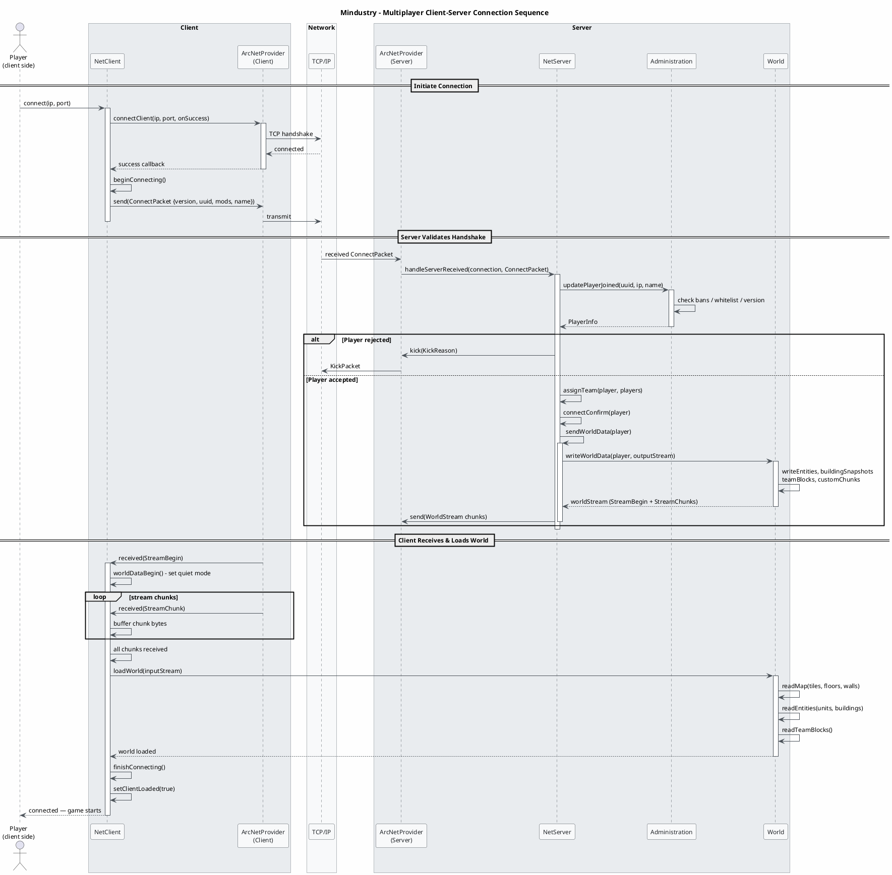
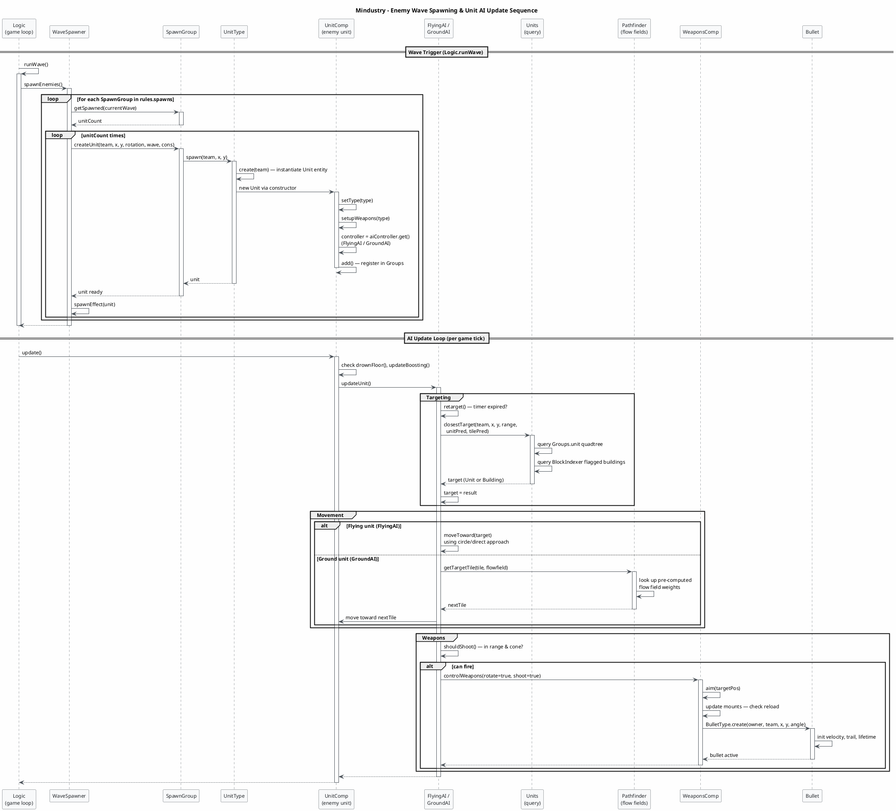

Looking at the Mindustry IR, I'll generate three focused sequence diagrams covering the most important runtime flows: game initialization, multiplayer connection, and the wave spawning + unit AI update cycle.

