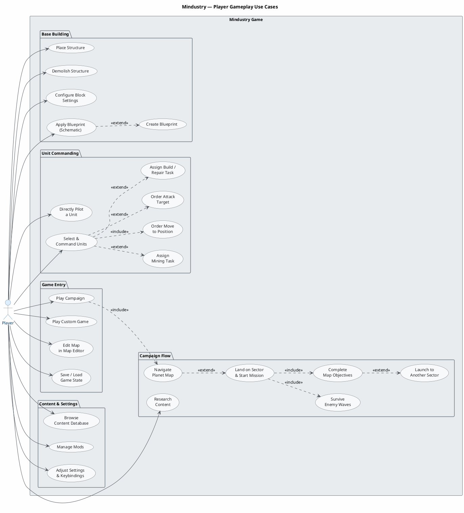
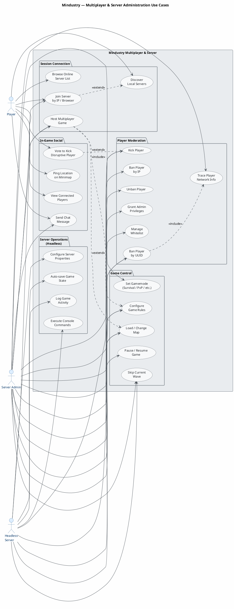

Looking at the Mindustry IR, I can identify the key actors and use cases from:
- **`Control.java`** — `playMap()`, `playSector()`, `createPlayer()`
- **`InputHandler.java`** — building, commanding units, mining, schematics
- **`UI.java`** — all dialog types reveal system capabilities
- **`NetServer.java`** / **`NetClient.java`** — multiplayer hosting/joining, admin functions
- **`ServerControl.java`** — headless server operations

I'll produce two focused use case diagrams: one for core gameplay and one for multiplayer/administration.

---

---

