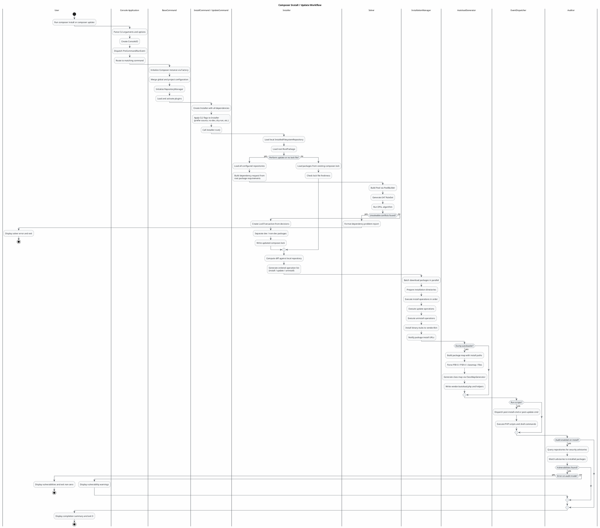
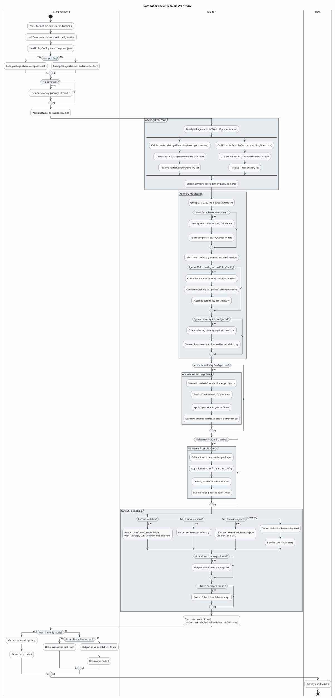

Looking at the Composer IR, I'll generate three focused activity diagrams covering the most important workflows: the main install/update process, the SAT dependency resolver, and the security audit flow.

```plantuml
@startuml composer_dependency_resolution

skinparam classAttributeIconSize 0
skinparam shadowing false
skinparam defaultFontName "Segoe UI"
skinparam defaultFontSize 12
skinparam backgroundColor #FEFEFE
skinparam ActivityBackgroundColor #F8F9FA
skinparam ActivityBorderColor #495057
skinparam ActivityArrowColor #495057
skinparam ActivityFontColor #212529
skinparam ActivityDiamondBackgroundColor #E9ECEF
skinparam PartitionBackgroundColor #E9ECEF
skinparam PartitionBorderColor #6C757D

title Composer Dependency Resolution — SAT Solver Flow

start

partition "Pool Building (PoolBuilder)" {
  :Receive root requirements and locked packages;
  :Mark root requirement names for loading;

  repeat
    :Load package versions from repositories\n(Composer, VCS, Path, Artifact);
    :Apply stability acceptability filters;
    :Create AliasPackage objects for branch aliases;
    :Mark transitive dependencies for loading;
    :Track already-loaded packages to avoid cycles;
  repeat while (Packages queued for loading?)

  if (Pool optimizer configured?) then (yes)
    :Group packages by name;
    :Compute dependency hash per package version;
    :Remove versions with identical dependency signatures;
    :Remove packages that cannot satisfy any constraint;
  endif

  if (Security advisory pool filter active?) then (yes)
    :Query AdvisoryProviderInterface repositories;
    :Identify affected package versions;
    :Remove vulnerable versions from pool;
    :Record removals in securityRemovedVersions;
  endif

  if (Filter list pool filter active?) then (yes)
    :Build locked package name-version map;
    :Fetch filter entries from FilterListProviders;
    :Remove blocked non-locked versions from pool;
    :Record removals in filterListRemovedVersions;
  endif

  :Dispatch PrePoolCreateEvent (plugins may modify);
  :Finalize Pool with all package arrays;
}

partition "Rule Generation (RuleSetGenerator)" {
  :Add assertion rules for fixed packages;
  :Add require rules for root package dependencies;

  repeat
    :Process next unvisited package in pool;
    :Create Rule2Literals for each require link;
    :Create conflict rules for conflicting packages;
    :Add rules for packages that provide replacements;
  repeat while (Unvisited packages in pool?)

  :Add GenericRule assertions for root aliases;
}

partition "SAT Solving — DPLL (Solver)" {
  :Initialize RuleWatchGraph with all rules;
  :Initialize empty Decisions queue;
  :Process assertion rules via unit propagation;
  :Populate fixedMap from request fixed packages;

  repeat
    :Check for root-required packages with no candidates;
    :Select lowest-ID undecided package literal;
    :Query DefaultPolicy for preferred package version\n(stable first, prefer-lowest, pinned versions);
    :Record decision in Decisions queue;
    :Propagate via RuleWatchGraph;

    if (Watch graph reports conflict?) then (yes)
      :Call analyze() on conflict rule;
      if (Conflict level == 0?) then (yes)
        :analyzeUnsolvable — record Problem;
        :Continue to collect remaining problems;
      else (no)
        :Backjump to learned conflict level;
        :Add learned rule to rule set;
        :Revert Decisions to conflict level;
        :Re-propagate from learned assertion;
      endif
    endif
  repeat while (Undecided literals remain in pool?)
}

if (Problems list non-empty?) then (yes)
  :Collect all Problem::getPrettyString() messages;
  :Include missing package hints;
  :Include platform requirement details;
  :Include version availability context;
  :Throw SolverProblemsException;
  stop
endif

partition "Transaction Generation (LockTransaction)" {
  :Iterate decided install literals;
  :Map literals to PackageInterface objects;
  :Classify: present / new / updated / removed;
  :Create InstallOperation for new packages;
  :Create UpdateOperation for version changes;
  :Create UninstallOperation for removed packages;
  :Create MarkAliasInstalled for alias packages;
  :movePluginsToFront — plugins install first;
  :moveUninstallsToFront — remove before install;
}

:Return ordered Transaction operation list;
stop

@enduml
```

