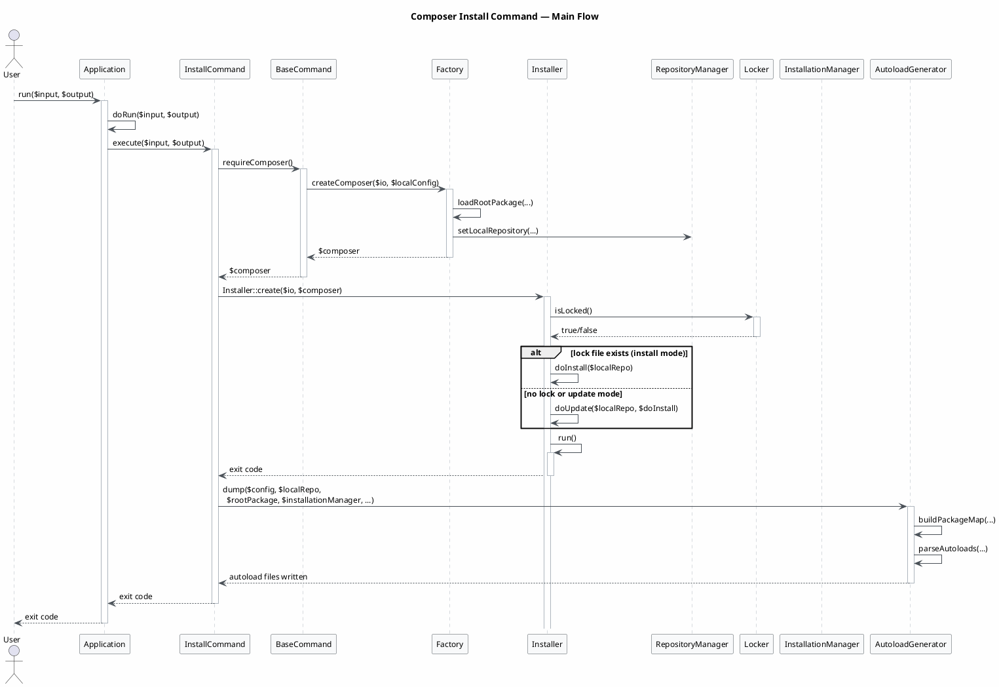
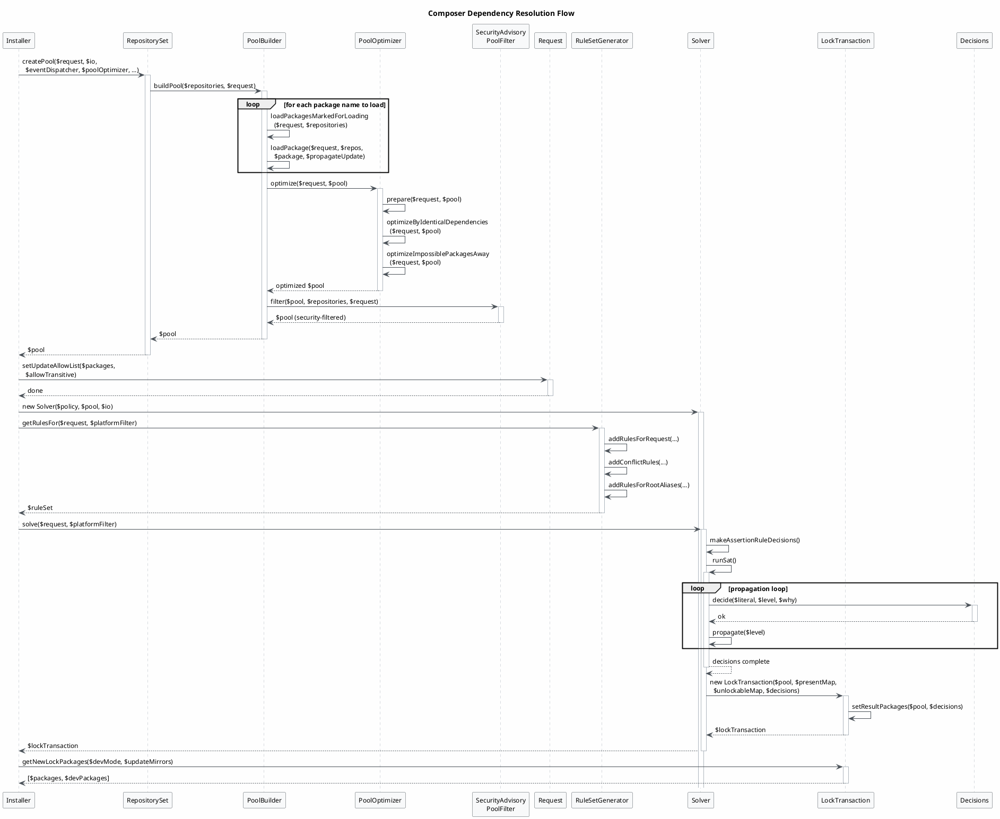
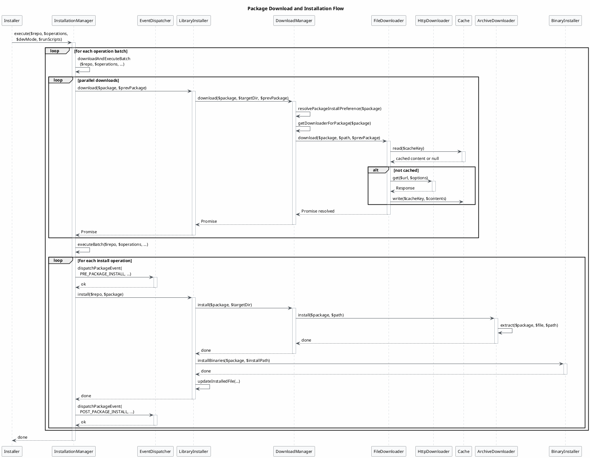
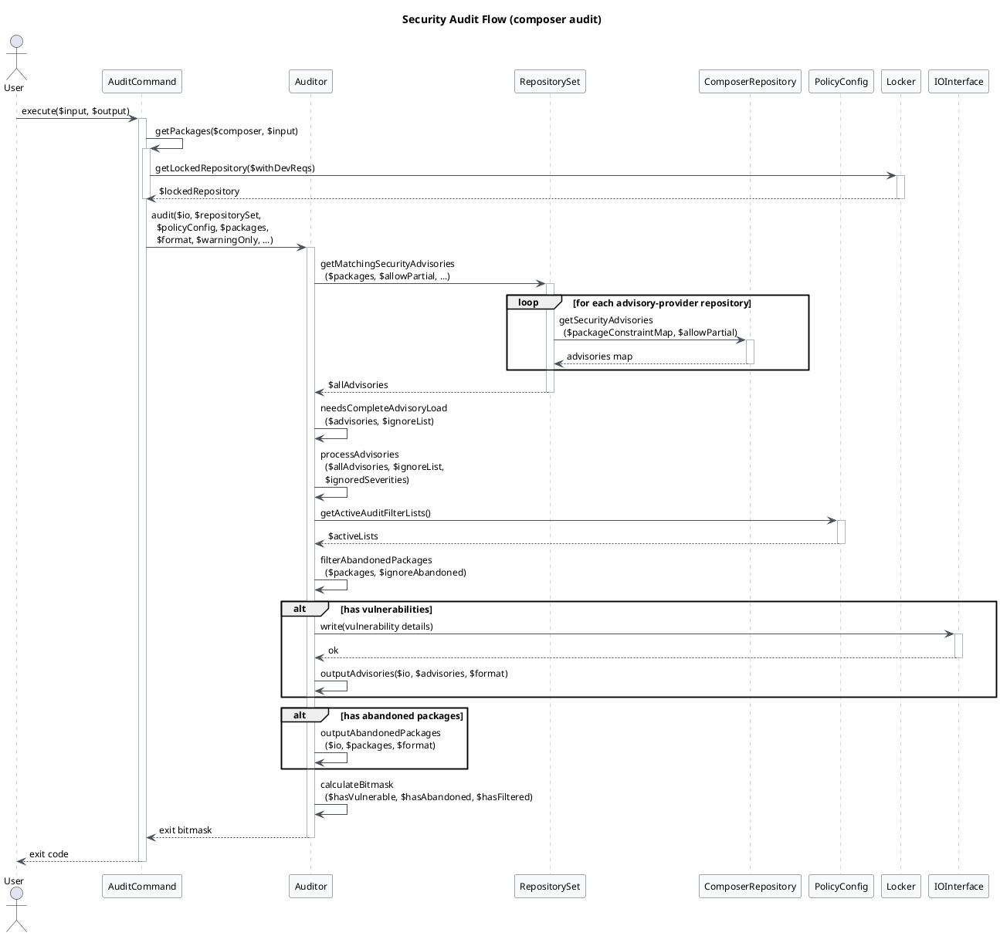
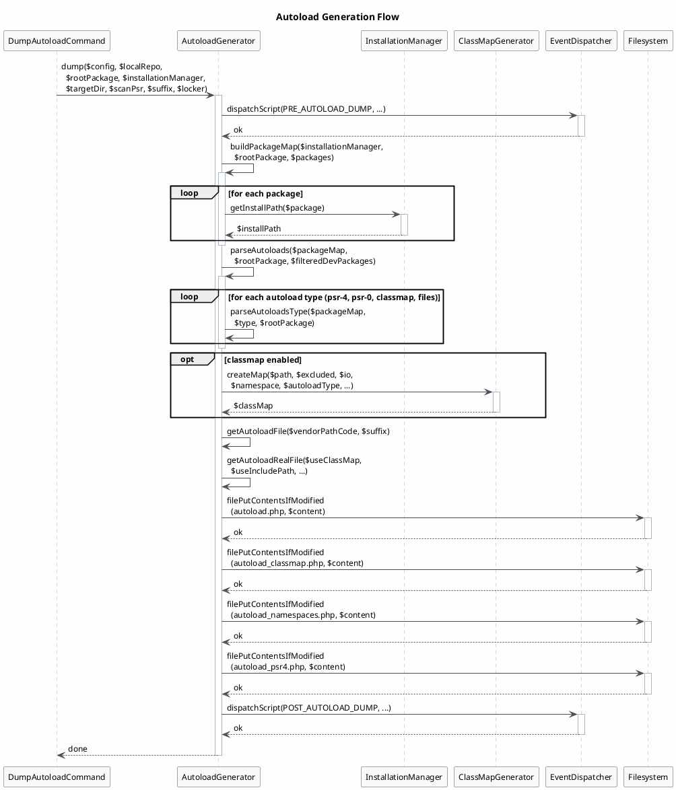

Looking at the Composer IR, I'll generate several focused sequence diagrams covering the main runtime flows: the install command flow, dependency resolution, and package download/installation.

