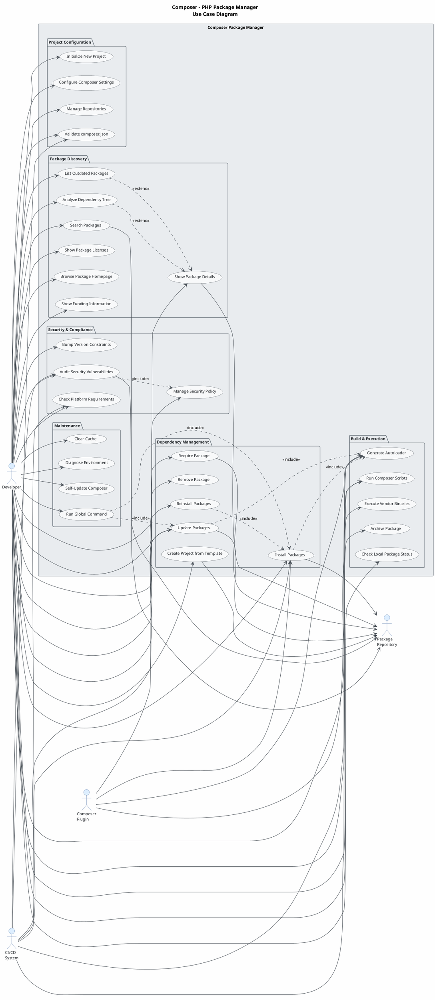

Looking at the IR for the Composer project, I can identify:

**Actors:**
- Developer (primary user via CLI)
- CI/CD System (automated pipelines)
- Package Repository (Packagist/VCS — secondary/supporting)
- Composer Plugin (extension system)

**Use cases** derived from the 35+ command classes, services, and sub-systems.

