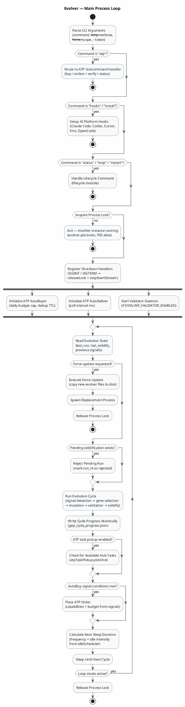
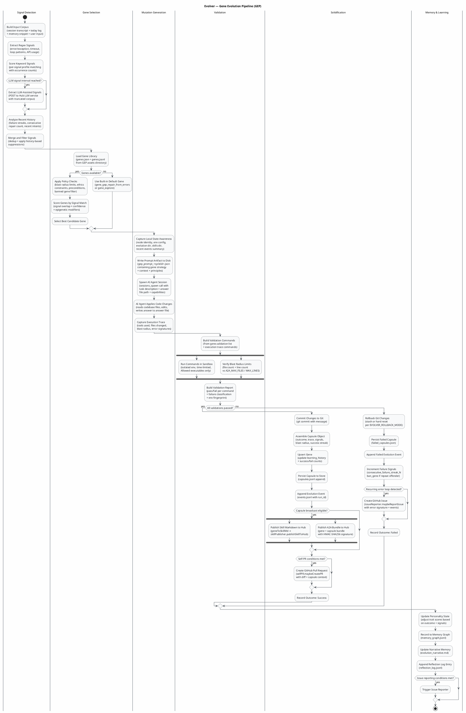
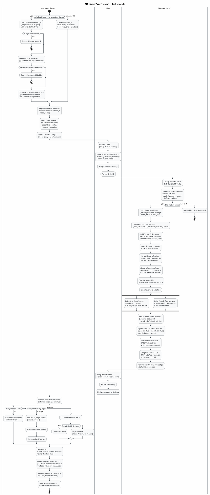

Looking at the IR for the "evolver" project, I can identify three key workflows to diagram:

1. **Main Process Loop** — top-level orchestration (`index.js`)
2. **Gene Evolution Pipeline** — the core GEP cycle (signal detection → gene selection → mutation → validation → solidification)
3. **ATP Task Lifecycle** — the Agent Task Protocol buying/selling flow

