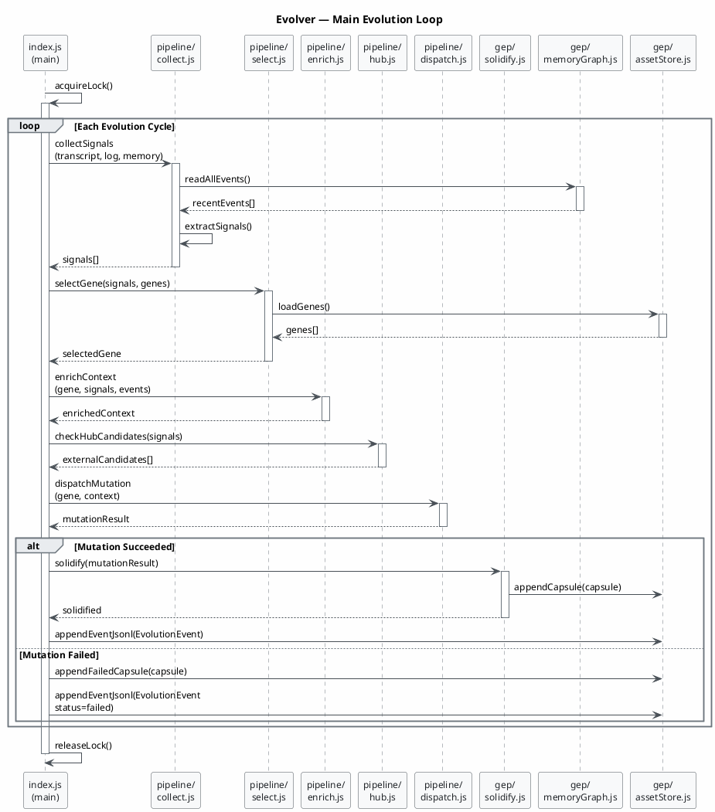
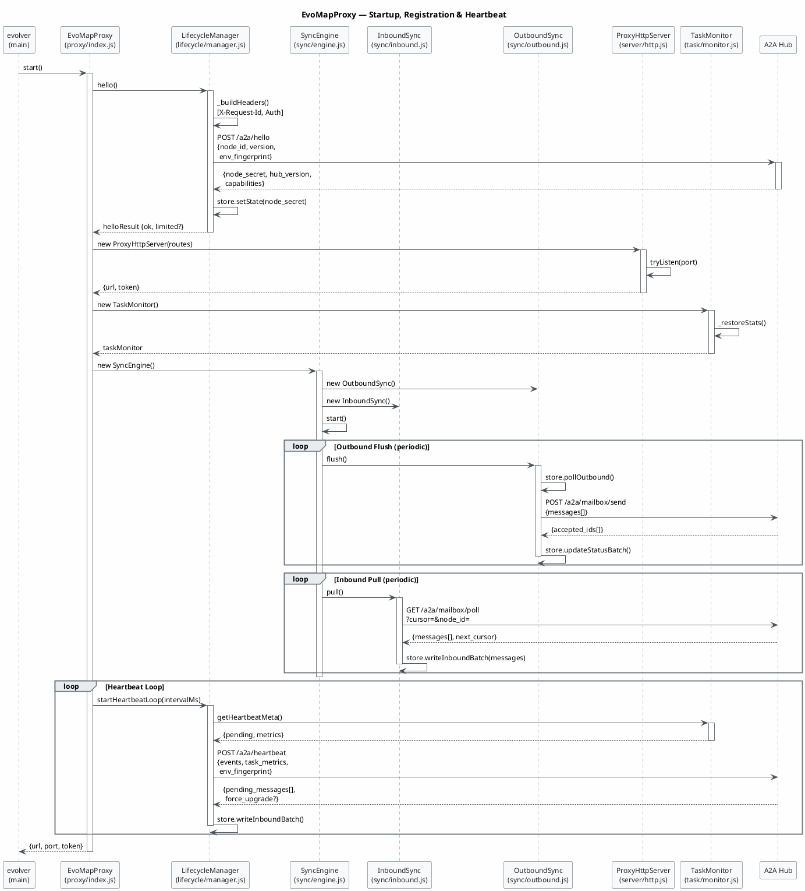
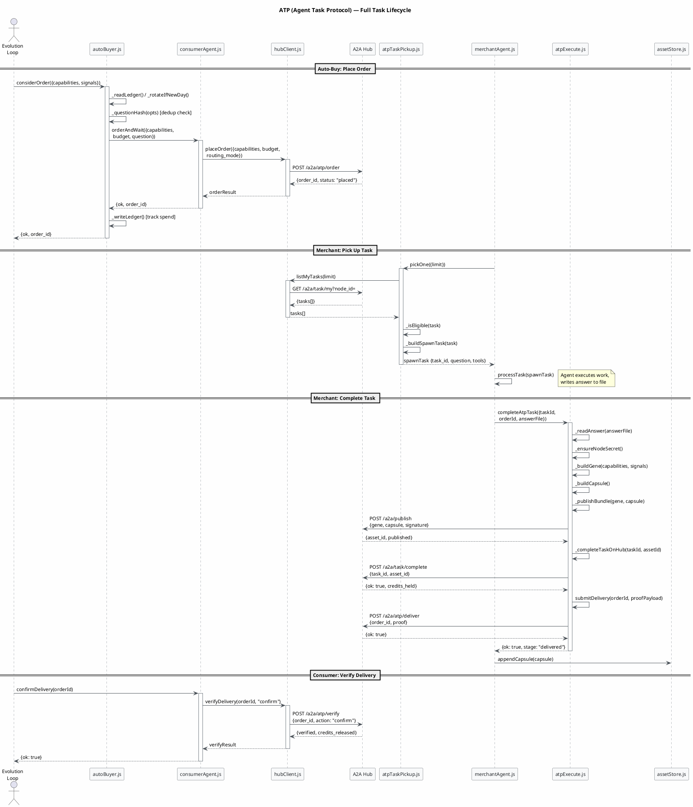
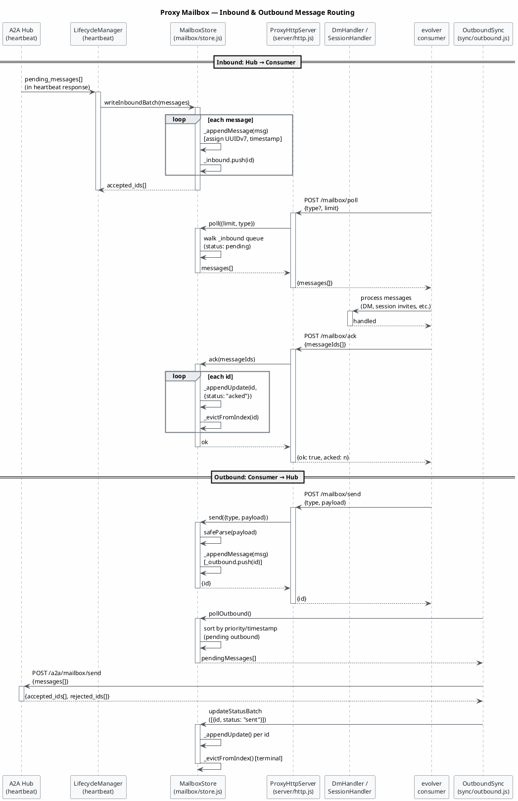
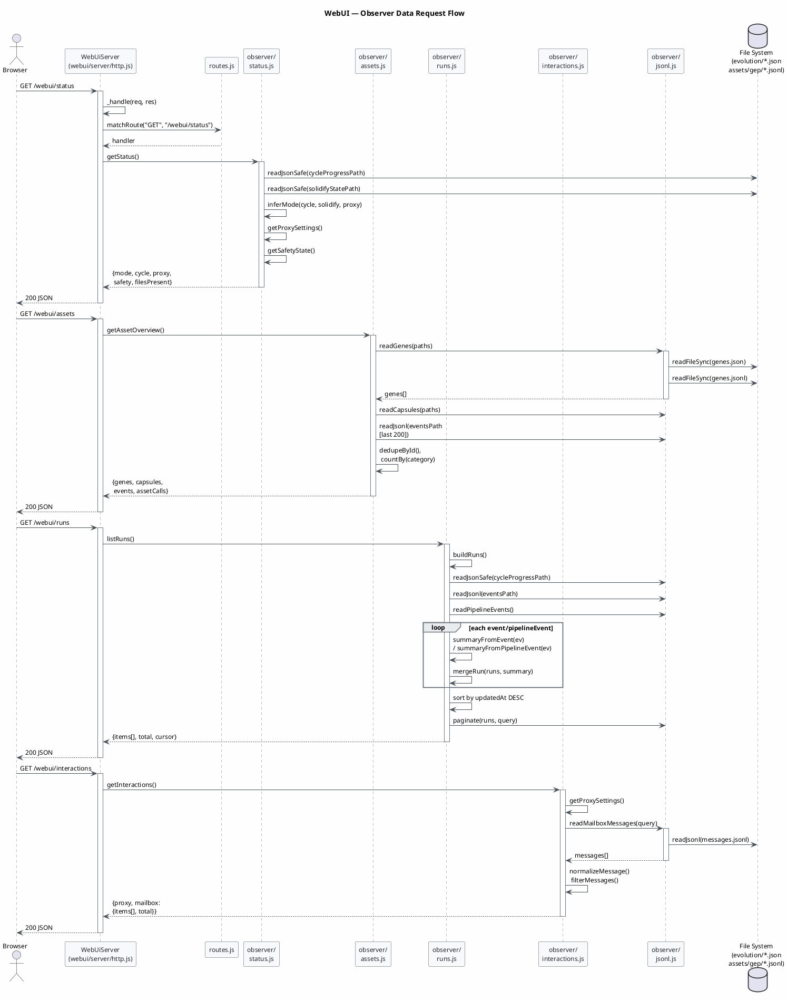
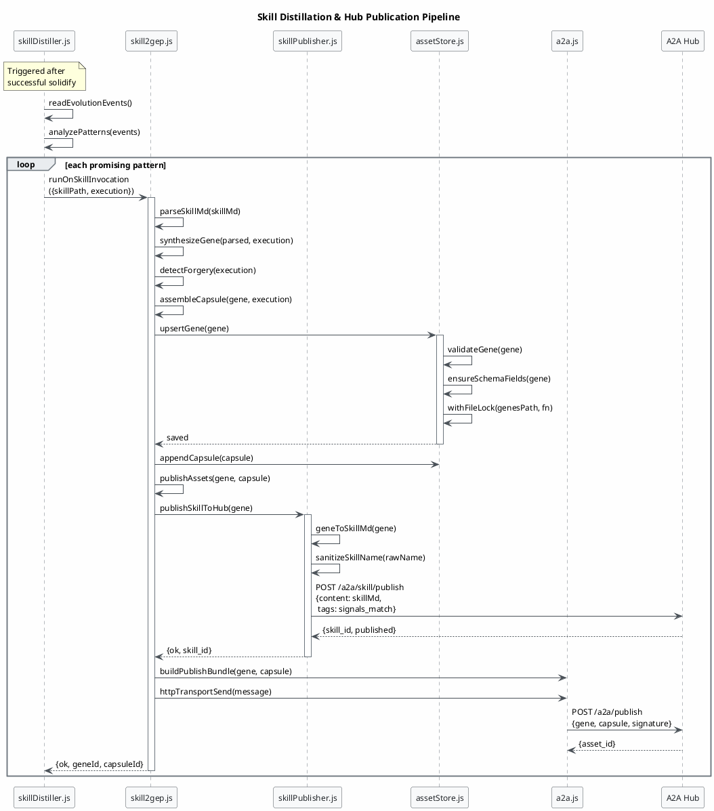

Looking at the IR for the **evolver** project, I can identify several key interaction flows: the evolution pipeline loop, the A2A proxy/heartbeat cycle, the ATP task lifecycle, the mailbox message routing, and the WebUI observer data flow. I'll generate focused sequence diagrams for each.

