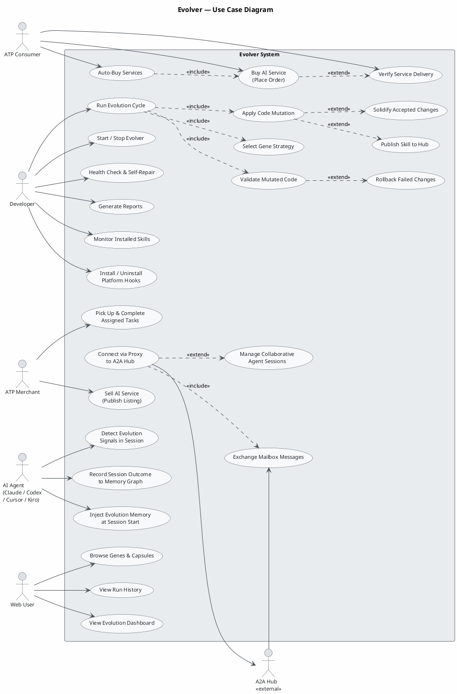

Looking at the IR, I can identify the key actors and use cases for the **evolver** project — a self-evolving AI agent system with an evolution engine, ATP marketplace, proxy communication layer, platform hook adapters, and a web UI. Let me produce a focused use case diagram.

---

### Diagram Overview

| Area | Key Actors | Notable Relationships |
|---|---|---|
| **Platform Hooks** | AI Agent (Claude/Codex/Cursor/Kiro) | Hooks inject memory at session start and capture outcome signals |
| **Evolution Engine** | Developer (triggers cycle) | `RunEvolutionCycle` always includes gene selection, mutation, and validation; solidification/rollback extend mutation/validation respectively |
| **ATP Marketplace** | Consumer, Merchant | Auto-Buy includes Buy; Verify extends Buy (optional post-purchase step) |
| **Proxy & Comms** | A2A Hub (external) | Proxy always includes mailbox exchange; sessions are an optional extension |
| **Monitoring** | Web User, Developer | Dashboard, run history, skill reports are independently accessed |
