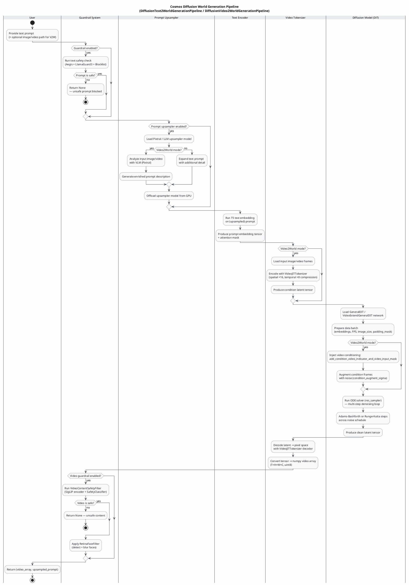
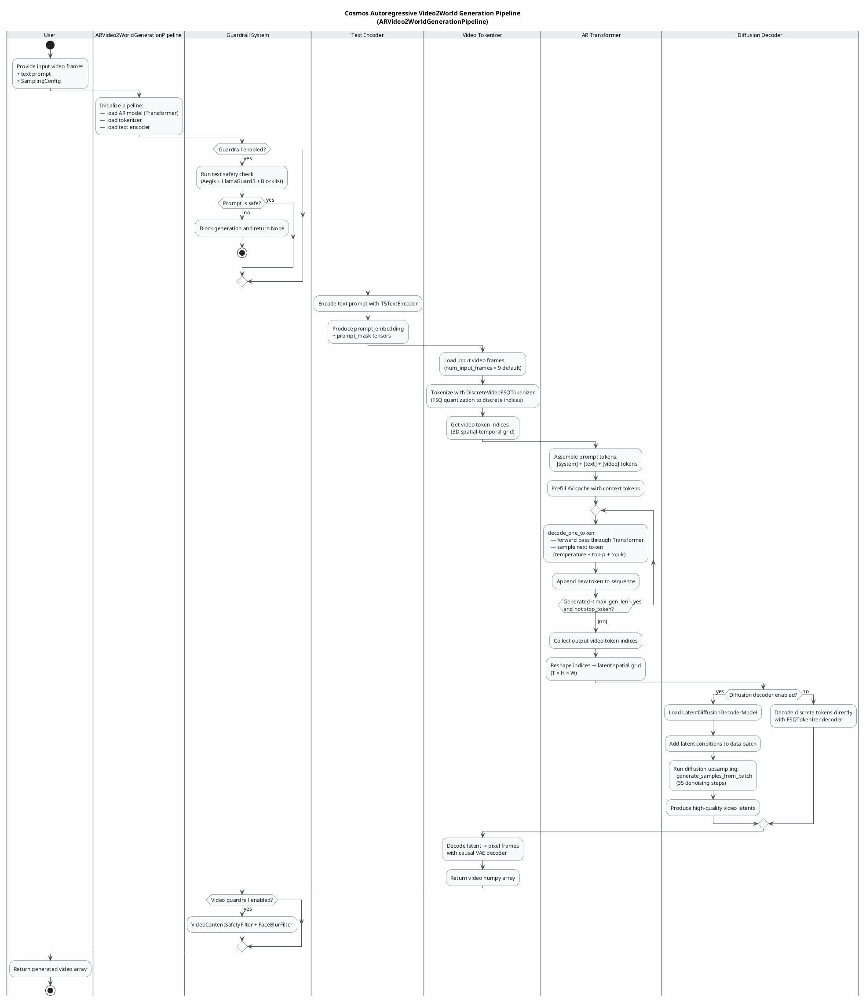
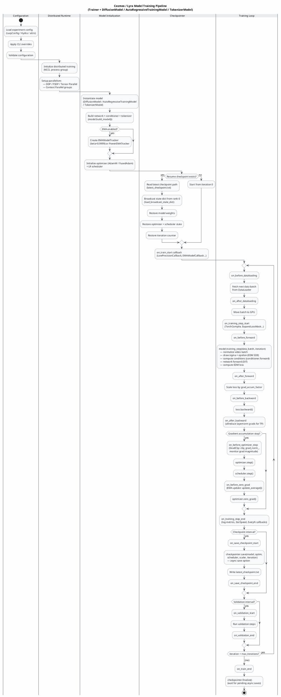
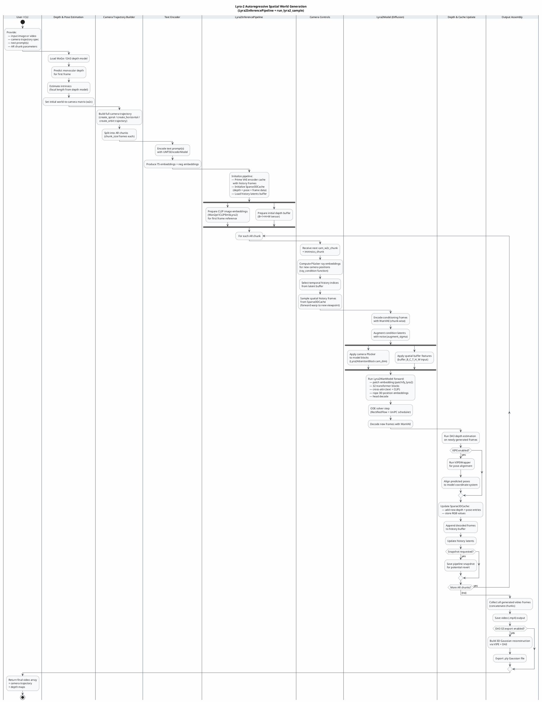

Looking at the IR for the **lyra** project, I can identify several major workflows:

1. Diffusion world generation pipeline (text/video → world)
2. Autoregressive video generation pipeline
3. Model training loop with callbacks/checkpointing
4. Lyra-2 autoregressive spatial inference

Here are four focused activity diagrams:

---

---

---

---

