```plantuml
@startuml lyra_diffusion_models
skinparam classAttributeIconSize 0
skinparam shadowing false
skinparam defaultFontName "Segoe UI"
skinparam defaultFontSize 11
skinparam backgroundColor #FEFEFE
skinparam class {
    BackgroundColor #F8F9FA
    BorderColor #495057
    ArrowColor #495057
    FontColor #212529
}
skinparam package {
    BackgroundColor #E9ECEF
    BorderColor #6C757D
}

title Lyra-1 — Diffusion Model Hierarchy

package "cosmos_predict1.diffusion.model" {

    class DiffusionT2WModel {
        +__init__(config)
        +set_up_tokenizer(tokenizer_dir)
        +build_model() : ModuleDict
        +generate_samples_from_batch(...) : Tensor
        +_get_conditions(...) : dict
    }

    class DiffusionV2WModel {
        +add_condition_video_indicator_and_video_input_mask(...) : VideoExtendCondition
        +generate_samples_from_batch(...) : Tensor
        +_augment_noise_with_latent(...) : tuple
        +_reverse_precondition_input(...)
        +_reverse_precondition_output(...)
    }

    class DiffusionMultiviewT2WModel {
        +generate_samples_from_batch(...) : Tensor
    }

    class DiffusionMultiviewV2WModel {
        +generate_samples_from_batch(...) : Tensor
        +add_condition_video_indicator_and_video_input_mask(...)
        +_augment_noise_with_latent(...)
    }

    class DiffusionGen3CModel {
        +encode_warped_frames(...)
        +_get_conditions(...)
        +add_condition_pose(...) : VideoExtendCondition
    }

    class DiffusionWorldInterpolatorWModel {
        +denoise(...) : DenoisePrediction
        +generate_samples_from_batch(...) : Tensor
        +get_x0_fn_from_batch_with_condition_latent(...)
    }
}

package "cosmos_predict1.diffusion.training.models" {

    abstract class ImageModel {
    }

    abstract class BaseModel {
    }

    class "DiffusionModel\n(training)" as DiffusionModelTrain {
        +setup_data_key()
        +training_step(...) : tuple
        +compute_loss_with_epsilon_and_sigma(...)
        +generate_samples_from_batch(...)
        +get_x0_fn_from_batch(...)
        +on_after_backward(...)
        +clip_grad_norm_(...)
    }

    class "FSDPDiffusionModel\n(training)" as FSDPDiffModel {
    }

    class ExtendDiffusionModel {
        +get_data_and_condition(...)
        +denoise(...) : VideoDenoisePrediction
        +generate_samples_from_batch(...)
        +add_condition_video_indicator_and_video_input_mask(...)
        +add_condition_pose(...)
        +sample_tokens_start_from_p_or_i(...)
    }

    class MultiviewExtendDiffusionModel {
        +denoise(...) : VideoDenoisePrediction
        +compute_loss_with_epsilon_and_sigma(...)
        +generate_samples_from_batch(...)
        +get_x0_fn_from_batch_with_condition_latent(...)
    }

    class InterpolatorDiffusionModel {
        +get_data_and_condition(...)
        +add_condition_video_indicator_and_video_input_mask(...)
    }

    class "FSDPExtendDiffusionModel" as FSDPExtModel {
    }
    class "FSDPInterpolatorDiffusionModel" as FSDPInterpModel {
    }
    class "FSDPExtendDiffusionModel\n(multiview)" as FSDPMultiviewExtModel {
    }

    class MultiviewDiffusionModel {
        +compute_loss_with_epsilon_and_sigma(...)
        +generate_samples_from_batch(...)
        +get_x0_fn_from_batch(...)
    }

    class "DiffusionWorldInterpolatorWModel\n(training)" as DiffusionWorldInterpTrain {
        +setup_data_key()
        +denoise(...) : VideoDenoisePrediction
        +generate_samples_from_batch(...)
        +add_condition_video_indicator_and_video_input_mask(...)
    }
}

' Inference hierarchy
DiffusionV2WModel --|> DiffusionT2WModel
DiffusionMultiviewT2WModel --|> DiffusionT2WModel
DiffusionMultiviewV2WModel --|> DiffusionV2WModel
DiffusionGen3CModel --|> DiffusionV2WModel
DiffusionWorldInterpolatorWModel --|> DiffusionV2WModel

' Training hierarchy
DiffusionModelTrain --|> ImageModel
FSDPDiffModel --|> DiffusionModelTrain
MultiviewDiffusionModel --|> DiffusionModelTrain
ExtendDiffusionModel --|> BaseModel
MultiviewExtendDiffusionModel --|> ExtendDiffusionModel
InterpolatorDiffusionModel --|> ExtendDiffusionModel
FSDPExtModel --|> ExtendDiffusionModel
FSDPInterpModel --|> InterpolatorDiffusionModel
FSDPMultiviewExtModel --|> MultiviewExtendDiffusionModel
DiffusionWorldInterpTrain --|> DiffusionV2WModel

@enduml
```

```plantuml
@startuml lyra_autoregressive
skinparam classAttributeIconSize 0
skinparam shadowing false
skinparam defaultFontName "Segoe UI"
skinparam defaultFontSize 11
skinparam backgroundColor #FEFEFE
skinparam class {
    BackgroundColor #F8F9FA
    BorderColor #495057
    ArrowColor #495057
    FontColor #212529
}
skinparam package {
    BackgroundColor #E9ECEF
    BorderColor #6C757D
}

title Lyra-1 — Autoregressive Model & Transformer Hierarchy

package "cosmos_predict1.autoregressive" {

    class AutoRegressiveModel {
        +__init__(model, tokenizer, config, ...)
        +get_num_params() : int
        +load_ar_model(shard_checkpoint, tokenizer_config)
        +load_tokenizer(tokenizer_config)
        +embed_vision_language_features(...) : Tensor
        +state_dict()
        +load_state_dict(...)
    }

    class AutoRegressiveTrainingModel {
        +__init__(model, tokenizer, config, ...)
        +get_num_params() : int
        +training_step(...) : tuple
        +embed_vision_language_features(...) : Tensor
        +on_after_backward(...)
        +on_before_zero_grad(...)
    }

    package "networks" {
        class "Transformer\n(inference)" as TransformerInf {
            +__init__(params, model_parallel, ...)
            +forward(...) : Tensor
            +apply_abs_pos_emb(...) : Tensor
            +_create_rope_config()
            +_create_token_embeddings(...)
            +state_dict()
        }

        class "Transformer\n(training)" as TransformerTrain {
            +__init__(params, model_parallel, ...)
            +forward(...) : Tensor
            +enable_context_parallel(cp_group)
            +set_inference_flag(flag)
            +init_weights()
            +on_after_backward()
            +_setup_peft()
        }

        class "TransformerBlock\n(inference)" as TransBlockInf {
            +__init__(layer_id, args)
            +forward(...) : Tensor
            +init_weights()
        }

        class "TransformerBlock\n(training)" as TransBlockTrain {
            +__init__(layer_id, model_parallel, args)
            +forward(...) : Tensor
            +init_weights()
        }

        class TransformerBlockTE {
            +__init__(layer_id, args, tp_group, ...)
            +forward(...) : Tensor
            +set_inference_flag(flag)
        }

        class VisionTransformer {
            +__init__(dim, num_channels, patch_size, ...)
            +forward(x) : Tensor
            +get_num_params() : int
            +expand_in_channels(new_in_channels)
        }

        class VisionTransformerBlocks {
            +__init__(n_layers, args)
            +forward(x, rope) : Tensor
        }
    }

    package "modules" {
        class "Attention\n(inference)" as AttnInf {
            +__init__(n_heads, n_kv_heads, dim, ...)
            +forward(x, rope, input_pos, ...) 
            +init_kv_cache(dtype)
            +load_hook(state_dict, prefix)
        }

        class "GQA\n(training)" as GQATrain {
            +__init__(n_heads, n_kv_heads, dim, ...)
            +forward(x, rope, input_pos, ...)
            +init_kv_cache(dtype)
            +set_inference_flag(flag)
            +init_weights(init_std)
        }

        class RotaryPositionEmbedding {
            +__init__(dim, max_position_embeddings, ...)
            +forward(seq_len) : Tensor
            +compute_freqs() : tuple
            +get_mscale(scale) : float
        }

        class RotaryPositionEmbeddingTE {
            +forward(seq_len, training_type) : Tensor
        }

        class RotaryPositionEmbeddingPytorch {
            +forward(q, k, input_pos, ...) : tuple
            +rotate_half(x) : Tensor
        }

        class RotaryPositionEmbeddingPytorchV2 {
            +__init__(seq_len, training_type)
            +create_rope_freqs(seq_len, training_type) : Tensor
            +forward(q, k, input_pos, ...) : tuple
        }

        class RotaryPositionEmbeddingPytorchV1 {
            +forward(q, k, input_pos, ...) : tuple
        }

        class MLP {
            +__init__(dim, hidden_dim, tensor_parallel_size)
            +forward(x) : Tensor
        }

        class TrainingMLP {
            +__init__(dim, hidden_dim, hidden_dropout, ...)
            +forward(x) : Tensor
            +init_weights(init_std)
        }

        class RMSNorm {
            +__init__(dim, eps, compile)
            +forward(x)
            +reset_parameters()
        }

        class MultimodalProjector {
            +__init__(mm_projector_type, in_dim, out_dim, ...)
            +forward(x) : Tensor
        }
    }
}

' AutoRegressive model composition
AutoRegressiveModel o-- TransformerInf : model
AutoRegressiveModel o-- VisionTransformer : vision_encoder
AutoRegressiveModel o-- MultimodalProjector : mm_projector

AutoRegressiveTrainingModel o-- TransformerTrain : model
AutoRegressiveTrainingModel o-- VisionTransformer : vision_encoder
AutoRegressiveTrainingModel o-- MultimodalProjector : mm_projector

' Transformer composition
TransformerInf *-- TransBlockInf : layers
TransformerTrain *-- TransBlockTrain : layers (pytorch)
TransformerTrain *-- TransformerBlockTE : layers (TE)

TransBlockInf *-- AttnInf : attention
TransBlockTrain *-- GQATrain : attention

VisionTransformer *-- VisionTransformerBlocks : blocks

' RoPE hierarchy
RotaryPositionEmbeddingTE --|> RotaryPositionEmbedding
RotaryPositionEmbeddingPytorch --|> RotaryPositionEmbedding
RotaryPositionEmbeddingPytorchV2 --|> RotaryPositionEmbedding
RotaryPositionEmbeddingPytorchV1 --|> RotaryPositionEmbedding

TransformerInf ..> RotaryPositionEmbeddingPytorchV2 : uses
TransformerTrain ..> RotaryPositionEmbeddingPytorch : uses

@enduml
```

```plantuml
@startuml lyra_tokenizer_vae
skinparam classAttributeIconSize 0
skinparam shadowing false
skinparam defaultFontName "Segoe UI"
skinparam defaultFontSize 11
skinparam backgroundColor #FEFEFE
skinparam class {
    BackgroundColor #F8F9FA
    BorderColor #495057
    ArrowColor #495057
    FontColor #212529
}
skinparam package {
    BackgroundColor #E9ECEF
    BorderColor #6C757D
}

title Lyra — Tokenizer & VAE Architecture

package "Base Abstractions" {
    abstract class BaseVAE {
        +__init__(channel, name)
    }

    interface VideoTokenizerInterface {
    }

    abstract class BasePretrainedVideoTokenizer {
        +__init__(pixel_chunk_duration, temporal_compress_factor, ...)
        +register_mean_std(vae_dir)
        +transform_encode_state_shape(state) : Tensor
        +transform_decode_state_shape(latent) : Tensor
        +get_latent_num_frames(num_pixel_frames) : int
        +get_pixel_num_frames(num_latent_frames) : int
    }

    abstract class BasePretrainedImageVAE {
        +__init__(name, latent_ch, is_image, is_bf16)
        +register_mean_std(vae_dir)
        +reset_dtype()
    }
}

package "cosmos_predict1.diffusion.module.pretrained_vae" {
    class JITVAE {
        +__init__(name, latent_ch, ...)
        +load_encoder(vae_dir)
        +load_decoder(vae_dir)
    }

    class VideoJITTokenizer {
        +__init__(name, latent_ch, ...)
    }

    class JointImageVideoTokenizer {
        +__init__(image_vae, video_vae, name, ...)
        +encode_image(state) : Tensor
        +decode_image(latent) : Tensor
        +get_latent_num_frames(...) : int
        +get_pixel_num_frames(...) : int
        +reset_dtype()
    }

    class JointImageVideoSharedJITTokenizer {
        +__init__(image_vae, video_vae, name, ...)
        +load_weights(vae_dir)
    }
}

package "cosmos_predict1.diffusion.training.module.pretrained_vae" {
    class "VideoJITTokenizer\n(training)" as VideoJITTrain {
        +__init__(enc_fp, dec_fp, name, mean_std_fp, ...)
    }

    class VideoJITVAEChunkWiseTokenizer {
        +__init__(enc_fp, dec_fp, name, ...)
        +get_latent_num_frames(...) : int
        +_impl_encode(state) : Tensor
    }

    class VideoStateDictTokenizer {
        +__init__(enc_fp, dec_fp, vae, name, ...)
    }

    class "StateDictVAE\n(training)" as StateDictVAETrain {
        +__init__(enc_fp, dec_fp, vae, name, ...)
        +load_encoder_and_decoder(...)
        +reset_dtype()
    }

    class DummyJointImageVideoTokenizer {
        +encode(state) : Tensor
        +decode(latent) : Tensor
        +get_latent_num_frames(...) : int
    }
}

package "cosmos_predict1.autoregressive.tokenizer" {
    class DiscreteMultimodalTokenizer {
        +__init__(tokenizer_config)
        +tokenize(data_batch)
        +_build_text_tokenizer()
        +_build_video_tokenizer()
        +_tokenize_text(raw_text, ...)
        +_tokenize_video(videos, ...)
    }

    class TextTokenizer {
        +__init__(model_family, is_instruct_model, ...)
        +encode(text, ...) : List[int]
        +decode(token_ids, ...) : str
        +tokenize(text, ...) : List[str]
        +apply_chat_template(...)
    }

    class ImageTextTokenizer {
        +__init__(model_family, is_instruct_model, ...)
        +encode(text, images, ...) : List[int]
        +apply_chat_template(...)
    }

    class "BaseDiscreteVideoFSQTokenizer" as BaseDiscVidTok {
        +__init__(name, latent_ch, ...)
        +reset_dtype()
    }

    class DiscreteVideoFSQJITTokenizer {
        +__init__(enc_fp, dec_fp, name, ...)
        +load_encoder(enc_fp)
        +load_decoder(dec_fp)
    }

    class DiscreteVideoFSQStateDictTokenizer {
        +__init__(enc_fp, dec_fp, tokenizer_module, ...)
        +load_encoder_and_decoder(...)
        +reset_dtype()
    }
}

package "lyra_2._src.tokenizers" {
    class "Wan2pt1VAEInterface" as WanVAE {
        +__init__(chunk_duration, ...)
        +encode(state) : Tensor
        +decode(latent) : Tensor
        +get_latent_num_frames(...) : int
        +reset_dtype()
    }

    class "VideoTokenizerInterface\n(Lyra-2)" as VideoTokIntLyra2 {
        +__init__()
    }
}

' VAE hierarchy (Lyra-1 diffusion module)
BasePretrainedImageVAE --|> BaseVAE
JITVAE --|> BasePretrainedImageVAE
VideoJITTokenizer --|> BasePretrainedVideoTokenizer
VideoJITTokenizer --|> JITVAE
VideoJITTokenizer ..|> VideoTokenizerInterface
JointImageVideoTokenizer --|> BaseVAE
JointImageVideoTokenizer ..|> VideoTokenizerInterface
JointImageVideoSharedJITTokenizer --|> JointImageVideoTokenizer

' Training VAE hierarchy
VideoJITTrain --|> BasePretrainedVideoTokenizer
VideoJITTrain --|> JITVAE
VideoJITTrain ..|> VideoTokenizerInterface
VideoJITVAEChunkWiseTokenizer --|> VideoJITTrain
VideoStateDictTokenizer --|> BasePretrainedVideoTokenizer
VideoStateDictTokenizer ..|> VideoTokenizerInterface
DummyJointImageVideoTokenizer --|> BaseVAE
DummyJointImageVideoTokenizer ..|> VideoTokenizerInterface

' Autoregressive tokenizer
DiscreteVideoFSQJITTokenizer --|> BaseDiscVidTok
DiscreteVideoFSQStateDictTokenizer --|> BaseDiscVidTok
ImageTextTokenizer --|> TextTokenizer
DiscreteMultimodalTokenizer o-- TextTokenizer : text_tokenizer
DiscreteMultimodalTokenizer o-- BaseDiscVidTok : video_tokenizer

' Lyra-2
WanVAE ..|> VideoTokIntLyra2

@enduml
```

```plantuml
@startuml lyra_networks_dit
skinparam classAttributeIconSize 0
skinparam shadowing false
skinparam defaultFontName "Segoe UI"
skinparam defaultFontSize 11
skinparam backgroundColor #FEFEFE
skinparam class {
    BackgroundColor #F8F9FA
    BorderColor #495057
    ArrowColor #495057
    FontColor #212529
}
skinparam package {
    BackgroundColor #E9ECEF
    BorderColor #6C757D
}

title Lyra — Network Architecture (DIT & WAN)

package "cosmos_predict1.diffusion.networks (inference)" {
    class "GeneralDIT\n(inference)" as GeneralDITInf {
        +__init__(max_img_h, max_img_w, max_frames, ...)
        +initialize_weights()
        +build_patch_embed()
        +build_pos_embed()
        +prepare_embedded_sequence(...) : tuple
        +forward_before_blocks(...) : Tensor
        +forward(...) : Tensor
        +enable_context_parallel(cp_group)
    }

    class "MultiviewGeneralDIT\n(inference)" as MultiviewDITInf {
        +build_patch_embed()
        +build_pos_embed()
        +prepare_embedded_sequence(...) : tuple
    }

    class "VideoExtendGeneralDIT\n(inference)" as VideoExtDITInf {
        +build_additional_timestamp_embedder()
        +initialize_weights()
        +forward(...) : Tensor
    }

    class "MultiviewVideoExtendGeneralDIT\n(inference)" as MVVidExtDITInf {
        +__init__(in_channels)
        +forward(...) : Tensor
    }

    class "DiffusionDecoderGeneralDIT" as DiffDecDIT {
        +prepare_embedded_sequence(...) : tuple
        +build_patch_embed()
        +enable_context_parallel(cp_group)
    }
}

package "cosmos_predict1.diffusion.training.networks" {
    class "GeneralDIT\n(training)" as GeneralDITTrain {
        +__init__(max_img_h, max_img_w, max_frames, ...)
        +init_weights()
        +build_patch_embed()
        +build_pos_embed()
        +prepare_embedded_sequence(...) : tuple
        +forward(...) : Tensor
        +enable_context_parallel(cp_group)
        +enable_sequence_parallel()
    }

    class "MultiviewGeneralDIT\n(training)" as MultiviewDITTrain {
        +build_patch_embed()
        +build_pos_embed()
        +prepare_embedded_sequence(...)
    }

    class "VideoExtendGeneralDIT\n(training LVG)" as VideoExtDITTrain {
        +build_additional_timestamp_embedder()
        +init_weights()
        +forward(...) : Tensor
    }

    class ActionConditionalGeneralDIT {
        +forward_before_blocks(...) : Tensor
        +forward(...) : Tensor
    }

    class ActionConditionalVideoExtendGeneralDIT {
        +__init__(in_channels, add_augment_sigma_embedding)
        +forward(...) : Tensor
        +forward_before_blocks(...) : Tensor
    }

    class "VideoExtendMultiviewGeneralDIT" as VidExtMVDIT {
        +forward(...) : Tensor
    }
}

package "lyra_2._src.networks" {
    abstract class WeightTrainingStat {
        +get_training_stats() : TrainingStats
        +_initialize_tracking_buffers()
    }

    class WanModel {
        +__init__(model_type, patch_size, text_len, ...)
        +forward(...) : Tensor
        +init_weights()
        +fully_shard(mesh)
        +enable_context_parallel(process_group)
        +disable_context_parallel()
        +enable_selective_checkpoint(sac_config, blocks)
    }

    class Lyra2WanModel {
        +__init__(model_type, patch_size, ...)
        +init_clean_patch_embeddings(...)
        +init_patch_embedding_buffer(buffer_in_dim)
        +copy_weights_to_clean_patch_embeddings()
        +forward(...) : Tensor
        +enable_context_parallel(process_group)
    }

    class WanAttentionBlock {
        +__init__(cross_attn_type, dim, ffn_dim, ...)
        +forward(x, e, seq_lens, video_size, ...)
        +init_weights()
    }

    class Lyra2AttentionBlock {
        +__init__(cross_attn_type, dim, ffn_dim, ...)
        +forward(x, e, seq_lens, video_size, ...)
        +init_weights()
    }

    class WanSelfAttention {
        +__init__(dim, num_heads, ...)
        +forward(x, seq_lens, video_size, ...)
        +set_context_parallel_group(...)
        +init_weights()
    }

    class WanT2VCrossAttention {
        +forward(x, context, context_lens)
    }

    class WanI2VCrossAttention {
        +forward(x, context, context_lens)
        +init_weights()
    }

    class "VideoRopePosition3DEmb\n(Lyra-2)" as VidRope3DLyra2 {
        +generate_embeddings(...)
        +cache_parameters()
    }

    class "VideoPositionEmb\n(Lyra-2)" as VidPosEmbLyra2 {
        +forward(x) : Tensor
        +generate_embeddings(...)
        +enable_context_parallel(process_group)
    }
}

' Inference DIT hierarchy
MultiviewDITInf --|> GeneralDITInf
VideoExtDITInf --|> GeneralDITInf
MVVidExtDITInf --|> MultiviewDITInf
DiffDecDIT --|> GeneralDITInf

' Training DIT hierarchy
MultiviewDITTrain --|> GeneralDITTrain
VideoExtDITTrain --|> GeneralDITTrain
ActionConditionalGeneralDIT --|> GeneralDITTrain
ActionConditionalVideoExtendGeneralDIT --|> ActionConditionalGeneralDIT
VidExtMVDIT --|> MultiviewDITTrain

' Lyra-2 WAN hierarchy
WanModel --|> WeightTrainingStat
Lyra2WanModel --|> WeightTrainingStat
WanModel *-- WanAttentionBlock : blocks
Lyra2WanModel *-- Lyra2AttentionBlock : blocks
WanAttentionBlock o-- WanSelfAttention : self_attn
WanAttentionBlock o-- WanT2VCrossAttention : cross_attn
WanI2VCrossAttention --|> WanSelfAttention
WanT2VCrossAttention --|> WanSelfAttention
VidRope3DLyra2 --|> VidPosEmbLyra2

@enduml
```

```plantuml
@startuml lyra_training_infra
skinparam classAttributeIconSize 0
skinparam shadowing false
skinparam defaultFontName "Segoe UI"
skinparam defaultFontSize 11
skinparam backgroundColor #FEFEFE
skinparam class {
    BackgroundColor #F8F9FA
    BorderColor #495057
    ArrowColor #495057
    FontColor #212529
}
skinparam package {
    BackgroundColor #E9ECEF
    BorderColor #6C757D
}

title Lyra — Training Infrastructure, Callbacks & Guardrails

package "cosmos_predict1.utils (Training Core)" {

    class Model {
        +__init__()
        +training_step(data_batch, iteration) : tuple
        +init_optimizer_scheduler(...) : tuple
        +on_train_start(memory_format)
        +on_before_zero_grad(optimizer, scheduler, iteration)
        +on_after_backward(iteration)
    }

    class Trainer {
        +__init__(config)
        +train(model, dataloader_train, dataloader_val)
        +training_step(model_ddp, optimizer, ...) : tuple
    }

    class Checkpointer {
        +__init__(config_checkpoint, config_job, callbacks)
        +save(model, optimizer, ...) : None
        +finalize()
    }

    abstract class AbstractCheckpointer {
        +finalize() : None
        +_read_latest_checkpoint_file() : str
        +_write_latest_checkpoint_file(checkpoint_file)
        +_check_checkpoint_exists(checkpoint_path)
    }

    class Callback {
        +on_train_start(model, iteration)
        +on_training_step_start(model, data, iteration)
        +on_before_optimizer_step(model_ddp, optimizer, ...)
        +on_before_zero_grad(...)
        +on_training_step_end(model, data_batch, ...)
        +on_save_checkpoint(model, state_dict)
        +on_load_checkpoint(model, state_dict)
    }

    class CallBackGroup {
        +__init__(config, trainer)
        +__getattr__(method_name) : Callable
    }

    class EMAModelCallback {
        +on_train_start(model, iteration)
        +on_training_step_end(model, data_batch, ...)
    }

    class GradClipCallback {
        +on_before_optimizer_step(...)
    }

    class LowPrecisionCallback {
        +on_train_start(model, iteration)
        +on_training_step_start(model, data, iteration)
    }

    class EMAModelTracker {
        +__init__(model, beta, ...)
        +copy_to(model)
        +cache(parameters, is_cpu)
        +restore(parameters)
    }

    class PowerEMATracker {
        +__init__(model, s, ...)
    }
}

package "cosmos_predict1.checkpointer" {
    class "DDPCheckpointer\n(Lyra-1)" as DDPCheck {
        +save(model, optimizer, ...) : None
        +load_broadcast_state_dict(...) : dict
        +format_checkpoint_filename(...) : str
        +keys_to_resume_during_load() : tuple
    }
    class "PEFTCheckpointer\n(Lyra-1)" as PEFTCheck {
        +load_broadcast_state_dict(...) : dict
    }
    class "TPCheckpointer\n(Lyra-1)" as TPCheck {
        +add_type_postfix_to_checkpoint_path(...) : str
    }
}

package "cosmos_predict1.diffusion.training.utils" {
    class "FSDPCheckpointer\n(diffusion)" as FSDPCheck {
        +save(model, optimizer, ...) : None
        +_load_ckpt_file_during_init()
        +finalize()
    }

    class MultiRankCheckpointer {
        +save(model, optimizer, ...) : None
    }
}

package "lyra_2._ext.imaginaire.checkpointer" {
    class DistributedCheckpointer {
        +__init__(config_checkpoint, config_job, ...)
        +save(model, optimizer, ...) : None
        +finalize()
        +maybe_wait_for_staging()
        +get_storage_writer(checkpoint_path)
        +get_storage_reader(checkpoint_path)
    }
    class "Checkpointer\n(Lyra-2 dummy)" as CheckLyra2 {
        +save(...)
        +load(...)
    }
    abstract class "AbstractCheckpointer\n(Lyra-2)" as AbsCheckLyra2 {
    }
}

package "Diffusion Callbacks" {
    class EveryN {
        +__init__(every_n, step_size, ...)
        +on_training_step_end(model, data_batch, ...)
    }

    class VideoSamplingTeacherForcing {
        +__init__(every_n, step_size, ...)
        +on_train_start(model, iteration) : None
    }

    class GradClip {
        +__init__(clip_norm, force_finite, ...)
        +on_before_optimizer_step(...)
    }

    class IterSpeed {
        +__init__(hit_thres)
        +on_training_step_end(...)
    }
}

package "cosmos_predict1.auxiliary.guardrail" {
    abstract class ContentSafetyGuardrail {
        +is_safe() : Tuple[bool, str]
    }

    abstract class PostprocessingGuardrail {
        +postprocess(frames) : ndarray
    }

    class GuardrailRunner {
        +__init__(safety_models, generic_block_msg, ...)
        +run_safety_check(input) : Tuple[bool, str]
        +postprocess(frames) : ndarray
    }

    class Aegis {
        +__init__(checkpoint_dir, device)
        +get_moderation_prompt(user_prompt) : str
        +is_safe(prompt) : tuple
    }

    class Blocklist {
        +__init__(checkpoint_dir, ...)
        +censor_prompt(input_prompt) : tuple
        +is_safe(input_prompt) : tuple
    }

    class LlamaGuard3 {
        +__init__(checkpoint_dir, device)
        +is_safe(prompt) : tuple
    }

    class VideoContentSafetyFilter {
        +__init__(checkpoint_dir, device)
        +is_safe(input) : Tuple[bool, str]
        +is_safe_file(filepath) : bool
        +is_safe_frames(frames) : bool
    }

    class RetinaFaceFilter {
        +__init__(checkpoint_dir, batch_size, ...)
        +postprocess(frames) : ndarray
        +blur_detected_faces(frames, ...) : list
    }
}

' Callback hierarchy
EMAModelCallback --|> Callback
GradClipCallback --|> Callback
LowPrecisionCallback --|> Callback
EveryN --|> Callback
VideoSamplingTeacherForcing --|> EveryN
GradClip --|> Callback
IterSpeed --|> EveryN
CallBackGroup o-- Callback : callbacks

' Checkpointer hierarchy (Lyra-1)
DDPCheck --|> AbstractCheckpointer
PEFTCheck --|> DDPCheck
TPCheck --|> DDPCheck
FSDPCheck ..> Model : saves

' Checkpointer hierarchy (Lyra-2)
DistributedCheckpointer --|> AbsCheckLyra2
CheckLyra2 --|> AbsCheckLyra2

' EMA
PowerEMATracker --|> EMAModelTracker
EMAModelCallback o-- EMAModelTracker : ema_tracker

' Guardrail hierarchy
Aegis --|> ContentSafetyGuardrail
Blocklist --|> ContentSafetyGuardrail
LlamaGuard3 --|> ContentSafetyGuardrail
VideoContentSafetyFilter --|> ContentSafetyGuardrail
RetinaFaceFilter --|> PostprocessingGuardrail
GuardrailRunner o-- ContentSafetyGuardrail : safety_models
GuardrailRunner o-- PostprocessingGuardrail : postprocessors

@enduml
```

```plantuml
@startuml lyra2_model_pipeline
skinparam classAttributeIconSize 0
skinparam shadowing false
skinparam defaultFontName "Segoe UI"
skinparam defaultFontSize 11
skinparam backgroundColor #FEFEFE
skinparam class {
    BackgroundColor #F8F9FA
    BorderColor #495057
    ArrowColor #495057
    FontColor #212529
}
skinparam package {
    BackgroundColor #E9ECEF
    BorderColor #6C757D
}

title Lyra-2 — Model Pipeline & Inference Architecture

package "lyra_2._ext.imaginaire" {
    class ImaginaireModel {
        +__init__()
        +training_step(data_batch, iteration) : tuple
        +init_optimizer_scheduler(...) : tuple
        +on_train_start(memory_format)
        +on_before_zero_grad(optimizer, scheduler, iteration)
        +on_after_backward(iteration)
    }

    class ImaginaireTrainer {
        +__init__(config)
        +train(model, dataloader_train, dataloader_val)
        +training_step(model_ddp, optimizer, ...) : tuple
    }

    class "Callback\n(Lyra-2)" as CallbackL2 {
        +on_train_start(model, iteration)
        +on_training_step_start(model, data, iteration)
        +on_before_optimizer_step(...)
        +on_training_step_end(...)
        +on_save_checkpoint(...)
    }

    class NVTXCallback {
        +on_before_forward(iteration)
        +on_after_forward(iteration)
        +on_before_backward(...)
        +on_before_optimizer_step(...)
    }

    class "EMAModelTracker\n(Lyra-2)" as EMATrackerL2 {
        +__init__(model, beta, ...)
        +copy_to(model)
        +cache(parameters, is_cpu)
        +restore(parameters)
    }

    class "PowerEMATracker\n(Lyra-2)" as PowerEMAL2 {
        +__init__(model, s, ...)
    }
}

package "lyra_2._src.models" {
    class WANDiffusionModel {
        +__init__(config: T2VModelConfig)
        +setup_data_key()
        +build_net()
        +training_step(data_batch, iteration) : tuple
        +get_x0_fn_from_batch(...) : Callable
        +get_data_and_condition(...) : tuple
        +denoise(...) : DenoisePrediction
        +load_lora_weights(lora_path, ...)
        +add_lora_to_model(adapter_name, ...)
        +get_video_height_width() : tuple
        +ema_beta(iteration) : float
        +state_dict() : dict
        +clip_grad_norm_(max_norm, ...)
    }

    class Lyra2Model {
        +__init__(config: Lyra2T2VConfig)
        +build_net()
        +get_data_and_condition(data_batch, ...) : tuple
        +training_step(data_batch, iteration)
        +denoise(xt, timestep, condition)
        +prepare_latent_conditon(...)
        +augment_conditional_latent_frames(...)
        +inference_dmd(history_latents, ...)
        +_apply_camera_controls(...)
    }

    class Lyra2T2VConfig {
    }

    class T2VModelConfig {
    }

    class EMAConfig {
    }

    class I4LoraConfig {
    }

    class Sparse3DCache {
        +__init__(downsample, store_device, ...)
        +add(depth_B_1_H_W, w2c_B_4_4, ...)
        +store_rgb(frame_id, rgb)
        +get_rgb_by_frame_id(frame_id) : Tensor
        +update_by_frame_id(frame_id, ...) : bool
    }
}

package "lyra_2._src.modules (Conditioners)" {
    abstract class BaseCondition {
        +to_dict(skip_underscore) : dict
        +broadcast(process_group) : BaseCondition
    }

    class T2VCondition {
        +edit_data_type(data_type) : T2VCondition
    }

    abstract class AbstractEmbModel {
        +random_dropout_input(in_tensor, ...) : Tensor
        +details() : str
        +summary() : str
    }

    class "GeneralConditioner\n(Lyra-2)" as GenCondL2 {
        +__init__(**emb_models)
        +_forward(batch, ...) : dict
        +get_condition_uncondition(data_batch) : tuple
        +get_condition_with_negative_prompt(data_batch) : tuple
    }

    class TextAttr {
        +__init__(input_key, dropout_rate)
        +forward(token)
        +random_dropout_input(in_tensor, ...) : Tensor
    }

    class TextAttrEmptyStringDrop {
        +forward(token)
        +random_dropout_input(...)
    }

    class ReMapkey {
        +forward(element) : dict
    }

    class Img2VidWan2pt1ConditionLyra2 {
        +broadcast(process_group) : BaseCondition
    }

    class Img2VidWan2pt1ConditionerLyra2 {
        +forward(batch, ...) : Img2VidWan2pt1ConditionLyra2
    }
}

package "lyra_2._src.inference" {
    class Lyra2InferencePipeline {
        +__init__(model, args, first_frame, ...)
        +autoregressive_step(cam_w2c_chunk, ...)
        +save_snapshot()
        +revert_to_snapshot() : bool
        +build_outputs(da3_gs_export_stem, log_prefix)
        +_update_depth_cache(end_px_idx)
    }

    class UMT5EncoderModel {
        +__init__(text_len, dtype, device, ...)
        +__call__(texts, device) : tuple
    }

    class VIPEWrapper {
        +__init__(overrides, config_dir, ...)
        +infer_frames(frames, fps, name) : VIPEOutputs
    }
}

package "lyra_2._src.schedulers" {
    class RectifiedFlow {
        +__init__(velocity_field, ...)
        +sample_train_time(batch_size)
        +get_interpolation(x_0, x_1, sigmas, ...)
        +get_x0_from_flow_prediction(...)
    }

    class FlowMatchScheduler {
        +__init__(num_inference_steps, ...)
        +set_timesteps(num_inference_steps, ...)
        +step(model_output, timestep, sample)
        +add_noise(original_samples, ...)
    }

    class FlowUniPCMultistepScheduler {
        +set_timesteps(num_inference_steps, ...)
        +convert_model_output(...) : Tensor
        +step(...) : Union[SchedulerOutput, Tuple]
    }
}

' Model hierarchy
WANDiffusionModel --|> ImaginaireModel
Lyra2Model --|> WANDiffusionModel

' Config associations
Lyra2T2VConfig --|> T2VModelConfig
WANDiffusionModel o-- T2VModelConfig : config
WANDiffusionModel o-- EMAConfig
WANDiffusionModel o-- I4LoraConfig
Lyra2Model o-- Sparse3DCache : spatial_cache

' Conditioner hierarchy
T2VCondition --|> BaseCondition
Img2VidWan2pt1ConditionLyra2 --|> T2VCondition
TextAttr --|> AbstractEmbModel
TextAttrEmptyStringDrop --|> AbstractEmbModel
ReMapkey --|> AbstractEmbModel
Img2VidWan2pt1ConditionerLyra2 --|> GenCondL2
GenCondL2 o-- AbstractEmbModel : emb_models

' Trainer associations
ImaginaireTrainer o-- ImaginaireModel : model

' Callbacks
NVTXCallback --|> CallbackL2
PowerEMAL2 --|> EMATrackerL2

' Inference
Lyra2InferencePipeline o-- Lyra2Model : model
Lyra2InferencePipeline o-- UMT5EncoderModel : t5_encoder
WANDiffusionModel ..> RectifiedFlow : uses
Lyra2Model ..> FlowMatchScheduler : uses

@enduml
```

Looking at the IR, this is a very large project (703 classes) spanning two major codebases: **Lyra-1** (cosmos_predict1) and **Lyra-2** (lyra_2). I'll generate focused class diagrams covering the key architectural subsystems.

---

---

---

---

---

---

