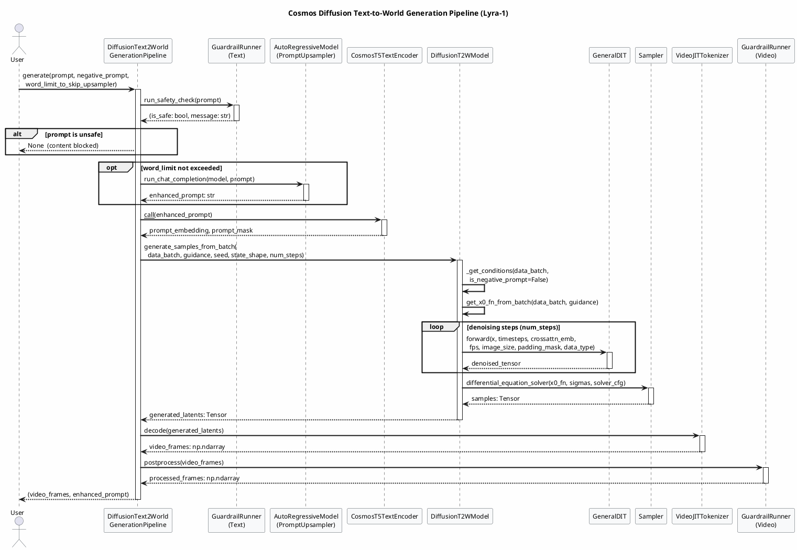
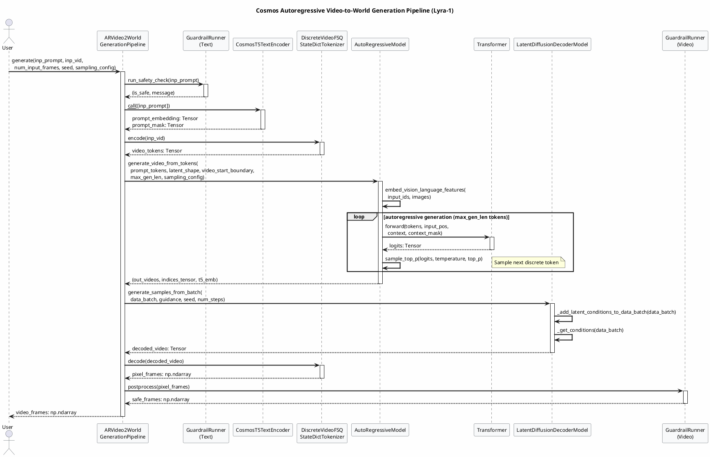
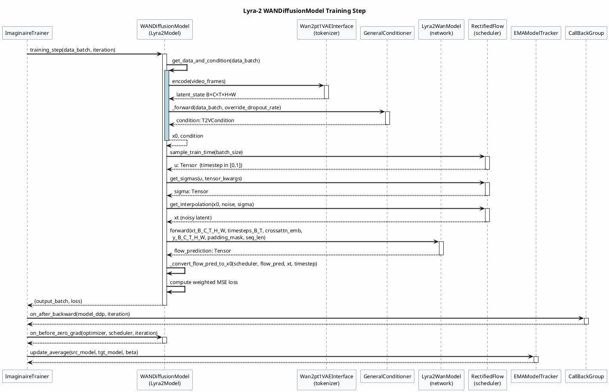
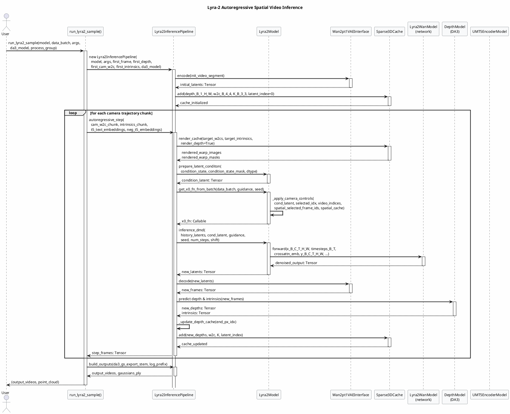

Looking at the IR for the **lyra** project, I can identify four key runtime flows spanning both Lyra-1 (cosmos_predict1) and Lyra-2 sub-systems. I'll produce focused sequence diagrams for each major pipeline.

---

---

---

---

