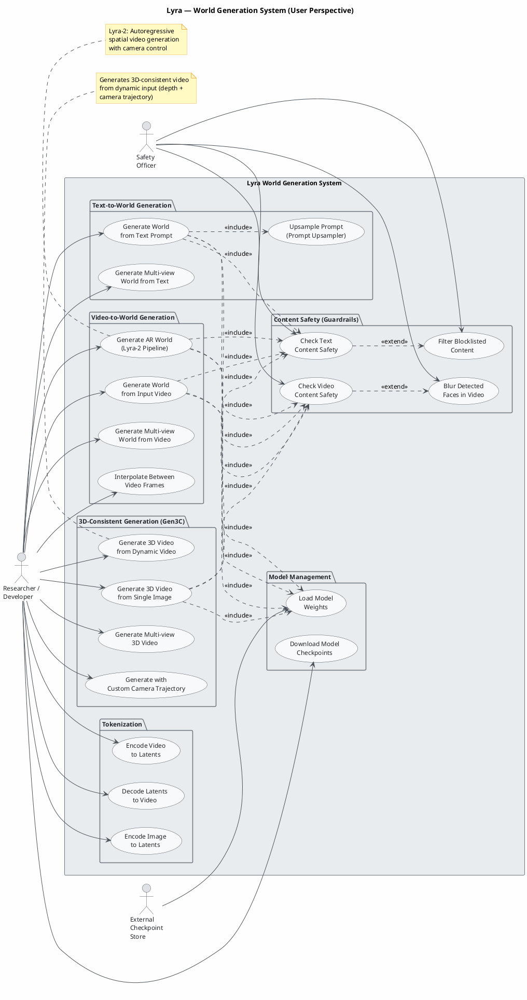
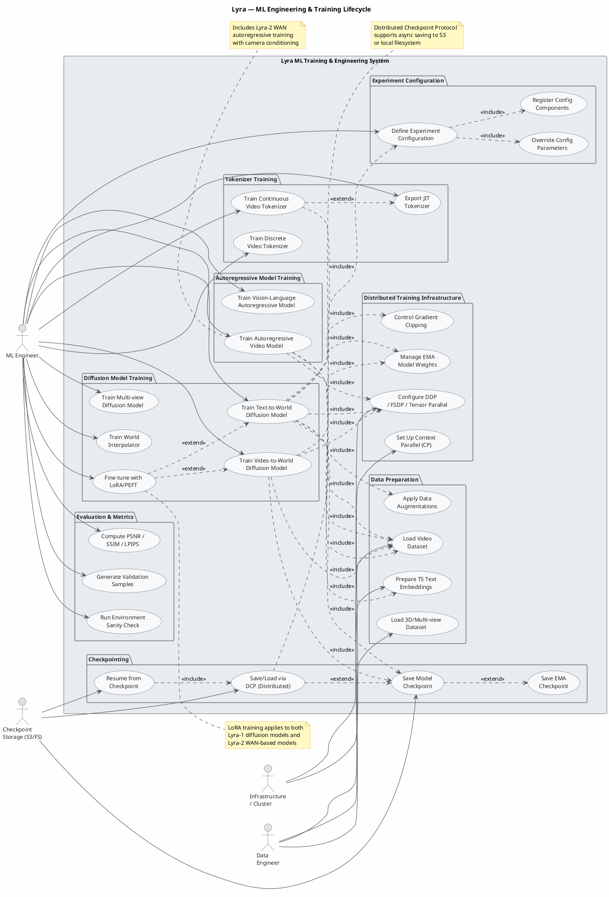

Looking at the IR, this is the **Lyra** project — an AI system for video world generation with two major versions (Lyra-1/cosmos_predict1 and Lyra-2/lyra_2). I'll produce two focused use case diagrams: one for end-user generation capabilities and one for the ML engineering/training lifecycle.

---

---

---

**Summary of diagrams:**

1. **Generation Use Case Diagram** — covers the end-user-facing capabilities:
   - Text-to-World and Video-to-World generation (Lyra-1 diffusion pipelines)
   - 3D-consistent generation (Gen3C) with single-image or dynamic video input
   - Autoregressive world generation with camera trajectory control (Lyra-2)
   - Content safety guardrails (Aegis, LlamaGuard3, video safety, face blur, blocklist)
   - Tokenization (encode/decode images and videos)
   - Checkpoint management

2. **ML Engineering Use Case Diagram** — covers the training/dev lifecycle:
   - Experiment configuration and registration (LazyConfig/Hydra system)
   - Dataset preparation (video, 3D/multi-view, T5 embeddings)
   - Training for diffusion models, autoregressive models, and tokenizers
   - Distributed infrastructure (DDP, FSDP, Tensor Parallel, Context Parallel)
   - Checkpointing (DCP async saves to S3, EMA model saving)
   - Evaluation metrics (PSNR, SSIM, LPIPS)
